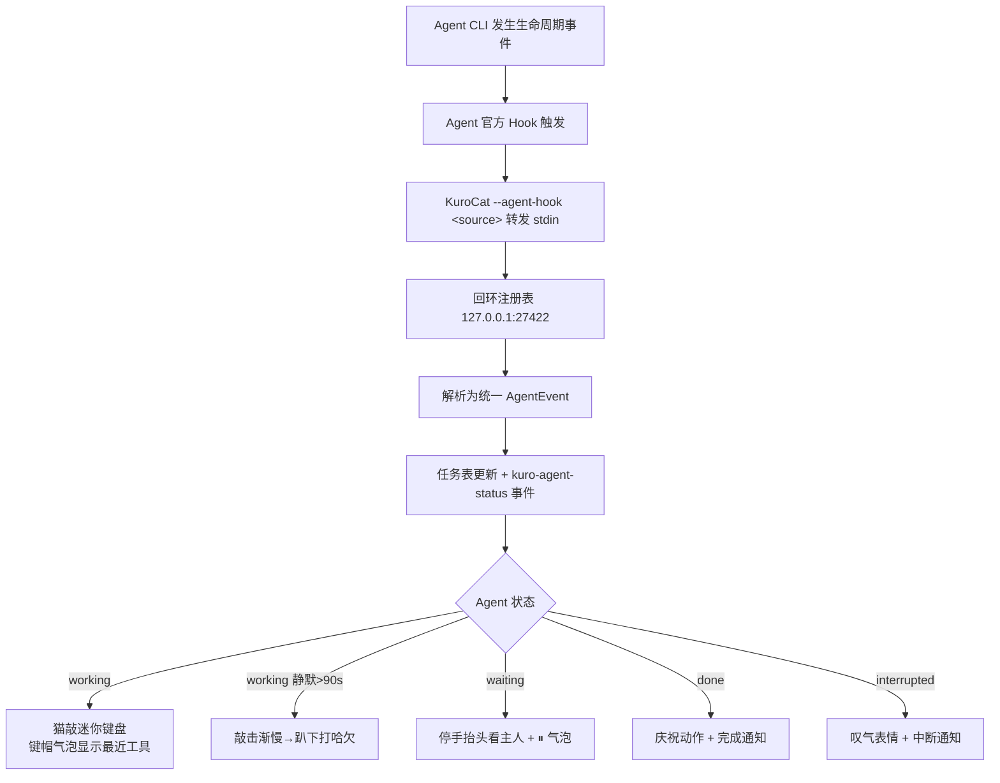
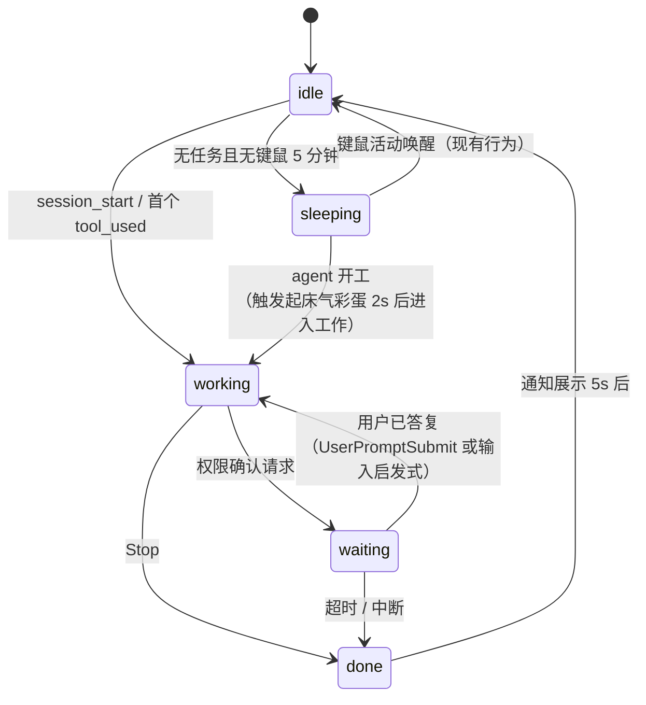
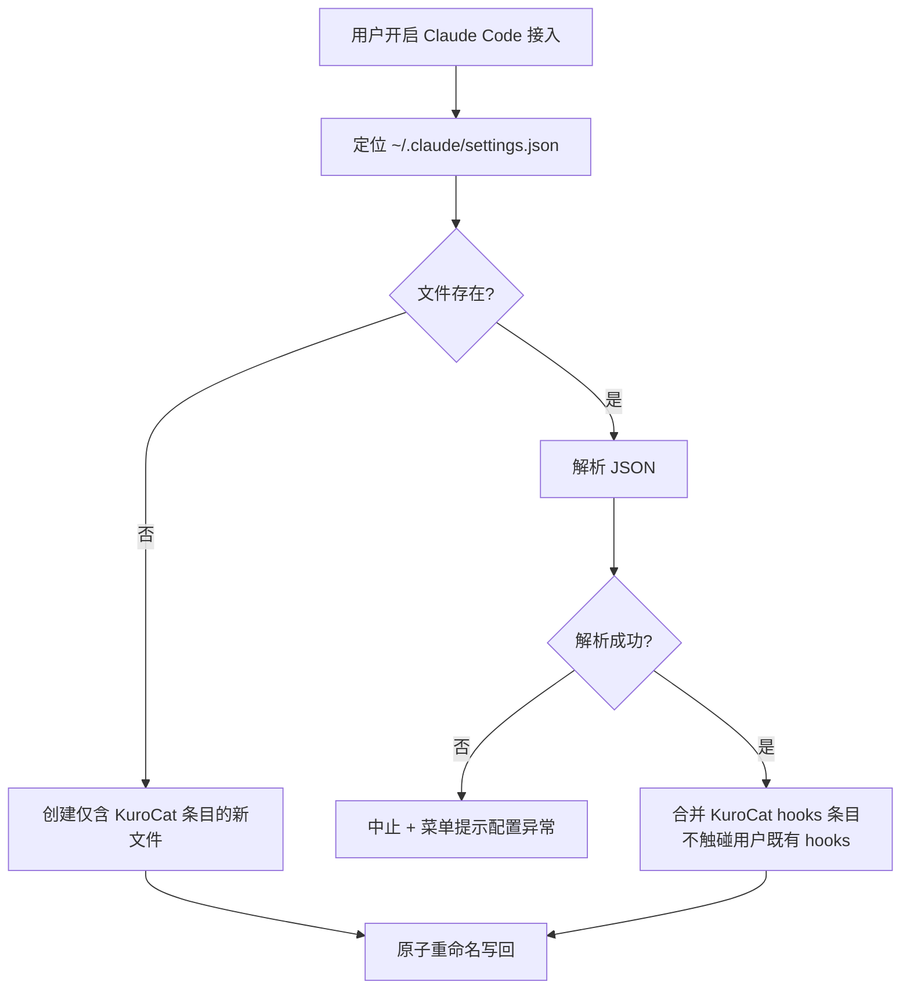
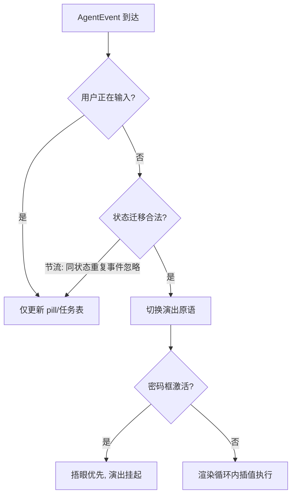

# KuroCat「数字工位同事」产品需求文档（PRD）

版本号：V5.2.0-PRD-1.0

| 版本 | 时间 | 修订人 | 备注 |
|------|-----------|--------|------|
| V1.0 | 2026/11/25 | liyuanjie | 创建；对应路线图 Now 期（R1a + R2 + R6），关联文档 [agent-era-roadmap.md](./agent-era-roadmap.md) |

---

## 一、概述（为什么做）

### 1.1 产品概述及目标

#### 1.1.1 背景介绍

KuroCat 已通过 v5.1.x 的 ZCode hooks 集成验证了「桌宠感知 coding agent」这条路：agent 开工/等确认/完成时，猫头顶显示进度 pill 并发出完成通知。但当前形态仍是**文字状态条**——竞品（OpenAI Codex desktop pets、agentpet、OpenPets）同质化地堆在这里。

KuroCat 独有的资产没有人用上：**成套的打字动画引擎、表情系统、起床气演出、2D/3D 双引擎**。一只「会打字的猫」面对一个「正在打字干活的 AI 同事」，最自然的下一步不是显示状态，而是**把 agent 的行为演出来**。

同时，现有 hooks 只支持 ZCode，Claude Code 用户（保有量更大）无法使用，功能价值被锁在小众源内。

#### 1.1.2 产品概述

v5.2 让 KuroCat 从「显示 agent 状态的桌宠」升级为「**数字工位同事**」：agent 干活时猫替它敲迷你键盘、等确认时猫抬头提醒你、完成时庆祝；同时把 ZCode hooks 模式抽象为 Agent 适配器架构并接入 Claude Code；开放 MCP 表达工具包，让任何 agent 能主动驱动猫的表情和动作——**你的 AI 同事第一次有了身体**。

#### 1.1.3 产品目标

**业务目标**（开源增长期）

| 目标 | 指标 | 目标值 | 达成时间 |
|------|------|--------|---------|
| 差异化传播 | 「猫替 agent 敲键盘」演示视频完播/转发 | 发布 1 支主视频 + README 首屏素材更新 | v5.2 发布周 |
| 扩大 agent 功能受众 | agent 状态功能可用用户群 | 从 ZCode 用户扩展到 Claude Code 用户（预计 ≥5×） | v5.2 发布 |
| 用户反馈量 | Agent 状态相关 issue/讨论 | ≥20 条（验证 R2 假设） | 发布后 1 个月 |

**用户目标**

| 目标用户 | 用户目标 | 衡量指标 |
|---------|---------|---------|
| Coding agent 用户 | 不切窗口即可余光感知 agent 状态 | waiting→用户响应时长缩短（主观反馈） |
| Coding agent 用户 | 被可爱的方式通知，而非打扰 | 演出功能无「太吵」负反馈（关闭率 <20%） |
| MCP 用户 | agent 完成任务时有具身反馈 | pet_* 工具调用量 >0 的会话占比 |

#### 1.1.4 目标用户

| 角色 | 描述 | 核心诉求 |
|------|------|---------|
| Agent 开发者 | 同时使用 ZCode / Claude Code 等 coding agent 的开发者 | 环境化感知 agent 状态，不被打断心流 |
| MCP 进阶用户 | 已把 KuroCat MCP 接入 AI 客户端的用户 | 让 agent 主动表达（完成庆祝、报错卖惨） |
| 直播/录屏创作者 | Next 期（OBS agent 源） | 人机结对编程的直播内容 |

### 1.2 名词说明

| 名词 | 说明 |
|------|------|
| Agent | 运行在本机的 coding agent CLI（ZCode、Claude Code 等） |
| Hook | Agent 官方提供的事件回调机制，KuroCat 借此感知 agent 生命周期 |
| 适配器（Adapter） | 面向单一 agent 的接入实现：hook 配置注入 + 事件解析 |
| 拟宠化（Embodiment） | 把 agent 状态翻译为猫的动作/表情演出 |
| 回环注册表 | KuroCat 内部 `127.0.0.1:27422` 事件汇聚服务（既有） |
| Turn / 任务 | 一次 agent 会话回合，从开工到完成/中断 |

### 1.3 角色及权限

| 角色 | 权限范围 | 数据范围 |
|------|---------|---------|
| 普通用户 | 开关 Agent 感知/拟宠化演出；选择启用的 agent 源 | 仅本机数据 |
| Agent（MCP 客户端） | 调用 `pet_emote/pet_say/pet_celebrate/pet_sleep` 表达工具 | 仅能驱动猫的演出，不可读取键鼠/文件 |

### 1.4 文档阅读对象

| 对象 | 关注内容 |
|------|---------|
| 研发 | 3.1 适配器架构、3.2 行为引擎状态机、数据字典 |
| UI/动画 | 3.2 状态映射表、2.3 全局交互 |
| 测试 | 5.1 验收标准（含配置还原 byte-identical 用例） |
| 社区贡献者 | 3.1.9 新增适配器指南 |

---

## 二、产品描述（做什么）

### 2.1 产品需求描述

**做**：
1. Agent 适配器架构 + Claude Code 适配（R1a）
2. 拟宠化行为引擎：agent 状态 → 猫的演出（R2）
3. MCP 表达工具包：agent 主动驱动猫（R6）

**不做**（本版明确排除）：Codex/Gemini CLI 适配（v5.3）、一键聚焦窗口（v5.3）、任何云端上报、任何需要用户配置 API key 的能力。

**约束**：回环注册表仅监听 127.0.0.1；hook 数据不出本机；用户手工配置的 hooks 永不被覆盖或删除。

### 2.2 产品整体流程

#### 2.2.1 主流程（数据流）



#### 2.2.2 状态转换图（单个 Agent 任务 + 猫的演出状态机）



#### 2.2.3 数据流图（DFD）

外部实体：Agent CLI（hook stdout→stdin）。处理：① `--agent-hook` 入口转发 → ② 回环注册表解析/任务表 → ③ 前端行为引擎 → ④ 猫的渲染（2D/3D）。数据存储：v5.2 无新增持久化（任务表为内存态；历史层属 v5.3 R5）。

### 2.3 全局说明

#### 2.3.1 全局异常处理

| 异常场景 | 处理方式 | 提示文案 |
|---------|---------|---------|
| 27422 端口被占 | 依次探测 27422-27431，hook 转发携带实际端口 | 无（静默降级） |
| Agent 配置文件损坏/非 JSON | 注入前备份原文件；解析失败则中止注入并保留原文件 | 菜单内提示「{Agent} 配置文件异常，已停止写入」 |
| Agent 未安装 | 托盘菜单对应项置灰 | 「未检测到 {Agent}」 |
| Hook 进程崩溃 | hook 是每事件短进程，无常驻；注册表 5s 超时丢弃 | 无 |
| 多实例 KuroCat | 仅首个实例启用注入；第二实例提示退出 | 已有逻辑沿用 |

#### 2.3.2 全局交互

| 场景 | 交互方式 |
|------|---------|
| 演出开关 | 托盘/右键菜单「Agent 拟宠化演出」，默认开；legacy 用户从 agent 状态开关继承 |
| 演出与用户打字冲突 | **用户真实键鼠永远优先**：用户敲键时 agent 演出降级为仅更新 pill |
| 演出与密码防偷窥冲突 | 密码捂眼状态优先级最高，agent 演出暂停 |
| 演出音 | 庆祝猫叫与完成通知音共用现有开关；演出本身默认静音（呼噜声开关独立） |
| 猫被拖动中 | 演出继续但不弹新气泡，避免视觉跳动 |

### 2.4 产品版本规划

| 版本 | 范围 | 计划时间 | 状态 |
|------|------|---------|------|
| v5.2.0 | R1a Claude Code 适配 + R2 拟宠化引擎 + R6 MCP 表达工具包 | 2026/12 | 设计中 |
| v5.3.0 | R3 一键聚焦 + R1b Codex/Gemini CLI + R5 工位日记 + R7 OBS agent 源 | 2027/Q1 | 规划中 |

### 2.5 产品框架

```
Agent CLI (ZCode | Claude Code | …)
   └─ Adapter 层：hook 配置注入(read-merge-atomic) + 事件解析 → 统一 AgentEvent
        └─ 回环注册表 (27422)：任务表 → kuro-agent-status 事件（既有）
             ├─ agentStatus.ts：pill / 通知（既有）
             ├─ [新] embodiment.ts：演出状态机 → 复用打字动画/表情/起床气
             └─ [新] MCP pet_* 工具 → 共享同一套演出原语
```

### 2.6 功能清单

| 模块 | 功能 | 优先级 | 版本 | 说明 |
|------|------|--------|------|------|
| Agent 适配层 | Claude Code hook 注入/卸载 | P0 | v5.2 | 复用既有注入模式 |
| Agent 适配层 | Adapter trait + 源注册表重构 | P0 | v5.2 | ZCode 迁移为首个 adapter |
| 拟宠化引擎 | 状态映射演出（工作/等待/完成/中断/长命令打哈欠） | P0 | v5.2 | 2D/3D 双引擎 |
| 拟宠化引擎 | 睡觉被 agent 吵醒→起床气 | P1 | v5.2 | 复用现有起床气 |
| MCP 表达 | pet_emote / pet_say / pet_celebrate / pet_sleep | P0 | v5.2 | 频控防刷屏 |
| MCP 表达 | README 用法引导（CLAUDE.md 示例） | P1 | v5.2 | — |

---

## 三、功能需求（怎么做）

### 3.1 Agent 适配层与 Claude Code 接入

#### 3.1.1 描述
把 `agent_hooks.rs` 中 ZCode 专用逻辑重构为「每 agent 一个适配器」的注册表架构，并新增 Claude Code 适配器，复用既有的 read-merge-atomic-rename 注入与 byte-identical 还原模式。

#### 3.1.2 用户故事
```
作为 Claude Code 用户，我希望安装 KuroCat 后我的猫能感知 Claude Code 的任务状态，
以便不切窗口就知道它在干活、等确认还是已完成。
作为多 Agent 用户，我希望在菜单里能按 agent 单独开关接入，
以便不想被某个 agent 打扰时只关掉它。
```

#### 3.1.3 前置条件

| 类型 | 条件 |
|------|------|
| 功能依赖 | 回环注册表（既有）；`--agent-hook` 入口（既有） |
| 数据依赖 | Claude Code 已安装且至少运行过一次（存在 `~/.claude/settings.json` 或可创建） |

#### 3.1.4 后置条件
- Claude Code 发生生命周期事件时猫收到 `AgentEvent`
- 关闭「Claude Code 接入」后其 settings.json 与注入前 **byte-identical**

#### 3.1.5 界面及交互

| 元素 | 类型 | 必填 | 默认值 | 校验规则 | 操作反馈 |
|------|------|------|--------|---------|---------|
| 「Agent 感知」子菜单 | 托盘/右键二级菜单 | — | — | 列出已装 agent，未装的置灰 | 点选即生效 |
| Claude Code 开关 | 菜单勾选项 | — | 开（首次检测到时默认开） | — | 勾选后 3s 内完成注入，pill 出现则生效 |
| ZCode 开关 | 菜单勾选项 | — | 沿用现有设置 | — | 不变（迁移后行为一致） |

#### 3.1.6 业务流程



#### 3.1.7 异常/分支流程

| 场景 | 触发条件 | 处理方式 | 提示文案 |
|------|---------|---------|---------|
| 用户已有同名 hook 命令 | settings.json 已有 KuroCat 条目（升级安装） | 按条目 id 幂等替换，不重复 | 无 |
| Claude Code 配置为项目级 | 使用 `.claude/settings.local.json` | 仅接管用户级文件，项目级不写入 | 无 |
| Hook 事件字段缺失 | payload 无 model/tool 名 | 字段置空，演出/pill 降级显示 | 无 |
| 卸载 KuroCat | 用户关闭接入或退出清理 | 移除 KuroCat 条目；用户条目保留 | 无 |

#### 3.1.8 数据字典（统一事件模型）

| 字段名 | 类型 | 必填 | 说明 | 示例值 |
|--------|------|------|------|--------|
| source | String | 是 | 适配器 id | `claude-code` |
| session_id | String | 是 | agent 会话标识 | `cc-3f2a…` |
| kind | Enum | 是 | session_start / tool_used / waiting / answered / done / interrupted | `tool_used` |
| tool_name | String | 否 | kind=tool_used/waiting 时提供 | `Edit` |
| model | String | 否 | kind=session_start 时提供 | `claude-sonnet-4-6` |
| ts | i64 | 是 | 毫秒时间戳 | `1764…` |

Claude Code 原生事件 → 统一事件映射：

| Claude Code hook 事件 | 统一事件 kind | 说明 |
|----------------------|--------------|------|
| SessionStart | session_start | 携带 model |
| PostToolUse | tool_used | 携带 tool_name |
| Notification（permission） | waiting | 携带被审批 tool_name |
| UserPromptSubmit | answered | 明确信号，替代输入启发式 |
| Stop | done | — |
| SubagentStop | 忽略 | 仅主会话驱动演出 |

#### 3.1.9 子功能：社区新增适配器指南
README 增加「接入一个新 Agent」章节：声明 adapter（source id / 显示名 / hook 配置片段 / 事件映射表）+ 提供 mock 事件测试命令 `KuroCat --agent-hook <source> --test-event <json>`，使社区可以不用抓包就自测。

---

### 3.2 拟宠化行为引擎（数字工位同事）

#### 3.2.1 描述
把 AgentEvent 翻译为猫的演出：工作时猫在自家迷你键盘上敲击并弹出键帽气泡、等待确认时抬头提醒、完成时庆祝、长命令时打哈欠、睡着被 agent 吵醒触发起床气。

#### 3.2.2 用户故事
```
作为并行开着多个窗口的开发者，我希望 agent 开始干活时猫自己也敲起键盘，
以便余光一扫就知道"它在干活，我可以去干别的"。
作为挂长任务的用户，我希望 agent 等我确认时猫抬头看我，
以便我不会因为忘了回应而白白等待十分钟。
作为桌宠爱好者，我希望任务完成时猫庆祝一下，
以便每次 agent 交付都变成一次小小的正反馈仪式。
```

#### 3.2.3 前置条件

| 类型 | 条件 |
|------|------|
| 功能依赖 | 3.1 适配层；既有打字动画/表情/起床气系统 |
| 配置依赖 | 「Agent 拟宠化演出」开关开启（默认开） |

#### 3.2.4 后置条件
- 猫的演出状态与 agent 实际状态偏差 ≤3s（waiting 场景要求即时）
- 演出不新增常驻定时器，不改变 30 FPS eco 档位功耗感知

#### 3.2.5 状态映射表（核心交付物，2D/3D 双实现）

| Agent 状态 | 猫的行为 | 键帽气泡 | 时长/退出 |
|-----------|---------|---------|----------|
| working（有活跃任务） | 在迷你键盘敲击，每个 tool_used 触发 2-4 次敲击 burst；节奏随事件频率自适应 | 显示最近工具名（`Bash` / `Edit` / `Write`…） | 状态机驱动 |
| working 静默 >90s（长命令） | 敲击渐慢→趴下打哈欠 | 气泡淡出 | 下一事件恢复敲击 |
| waiting | 停手、抬头看向观众方向 | ⏸ + 工具名 | 用户答复后 1s 内收回目光 |
| done | 挥手小跳庆祝（短，≤1.2s） | ✨ | 完成通知展示后 5s 回 idle |
| interrupted | 叹气/耳朵耷拉 | 💤→❗ | 同 done |
| sleeping 时 agent 开工 | 起床气演出 2s → 转 working | 💢 | 起床气被摸头秒消气（复用现有） |
| idle（无任务） | 现有行为：跟真实键鼠打字 | 现有 | — |

**仲裁规则**（按优先级从高到低）：① 密码防偷窥（捂眼） ② 用户真实键鼠输入 ③ agent 演出 ④ idle。用户敲键时 agent 演出让位，仅更新 pill——**陪伴用户永远是第一职责**。

#### 3.2.6 业务流程



#### 3.2.7 异常/分支流程

| 场景 | 触发条件 | 处理方式 | 提示文案 |
|------|---------|---------|---------|
| 多 agent 同时 working | ≥2 活跃任务 | 猫只演绎最近事件的任务；pill 照常显示全部（`N 个进行中`） | 无 |
| 事件风暴 | agent 短时大量 tool_used | 同状态事件合并节流（≥500ms 一次演出触发）；敲击 burst 上限 4 | 无 |
| 事件流中断（agent 被 kill -9） | lastEventMs 超时 | 既有 AGENT_ACTIVE_MS 逻辑回收任务；猫回 idle | 无 |
| 演出开关中途关闭 | 用户操作 | 当前演出在 ≤0.5s 内淡出，任务表/pill 不受影响 | 无 |

#### 3.2.8 数据字典（AgentTask 扩展）

| 字段名 | 类型 | 必填 | 说明 | 示例值 |
|--------|------|------|------|--------|
| last_tool | String | 否 | 最近一次工具名（新增，气泡用） | `Bash` |
| 其余字段 | — | — | id/source/label/model/waiting/tool/tools/startedMs/lastEventMs 沿用 `src/agentStatus.ts` 既有定义 | — |

---

### 3.3 MCP 表达工具包（让 Agent 获得身体）

#### 3.3.1 描述
在既有 MCP server 中新增 4 个演出工具，任何 MCP 客户端（Claude Desktop / Cursor / ZCode…）都能让猫做表情、说话、庆祝、入睡——agent 的状态表达从「被动被感知」升级为「主动具身表达」。

#### 3.3.2 用户故事
```
作为 agent 用户，我希望在 CLAUDE.md 里写一句"完成后调用 pet_celebrate"，
以便每次任务交付时我的猫替我开心一下。
作为 agent 用户，我希望 agent 卡住时能通过 pet_say 告诉我原因，
以便不用切回终端看报错。
```

#### 3.3.3 前置条件

| 类型 | 条件 |
|------|------|
| 功能依赖 | MCP server 开启（既有）；3.2 演出原语 |

#### 3.3.4 界面及交互（MCP 工具定义）

| 工具名 | 参数 | 返回 | 说明 |
|--------|------|------|------|
| `pet_emote` | emotion: enum(happy/angry/sleepy/surprised/shrug), duration_ms=3000 | ok | 播放一次性表情，与演出状态机仲裁 |
| `pet_say` | text ≤40字符, ttl_ms=6000 | ok | 猫头顶对话气泡 |
| `pet_celebrate` | — | ok | 复用 3.2 庆祝原语 |
| `pet_sleep` | on: bool | ok | 手动哄睡/唤醒（醒来带起床气） |

#### 3.3.5 异常/分支流程

| 场景 | 触发条件 | 处理方式 | 提示文案 |
|------|---------|---------|---------|
| 工具滥用 | 同会话 >10 次/分钟 | 超频调用静默丢弃并在返回中提示 `rate_limited` | MCP 返回值内 |
| 与 agent 演出冲突 | 拟宠化演出进行中 | pet_* 显式调用优先（视为 agent 主动表达），1 次演出后回到状态机 | 无 |
| 文本超长 | text >40 字符 | 截断加 `…` | 无 |
| 密码捂眼中 | — | 拒绝执行返回 `privacy_guard_active` | 无 |

#### 3.3.6 安全边界
工具只写演出状态，**不**暴露键鼠数据、屏幕内容、文件系统；`pet_say` 文本仅显示不落盘。**[待确认]** 是否在 menu 中显示「本次会话 MCP 演出次数」以便用户察觉异常刷屏。

---

### 3.4 一键聚焦 Agent 窗口（v5.3，概要）

用户故事：`作为多窗口开发者，我希望点击 pill 直接跳到对应 agent 终端，以便一键处理 waiting。`
方案方向：任务表记录来源进程线索（hook 触发时的父进程/窗口标题启发式），点击 pill → 平台 API 聚焦窗口。**[待确认]** 三平台窗口枚举与聚焦权限（macOS Accessibility 已授权，Windows 需验证，Linux X11/Wayland 差异大）。

---

## 四、非功能需求

### 4.1 安全与隐私

| 需求 | 说明 |
|------|------|
| 数据不出本机 | 回环注册表仅 127.0.0.1；hook payload、演出数据均不上报 |
| 配置不可破坏 | 注入原子写 + 卸载 byte-identical 还原（沿用既有测试基线，新增 Claude Code 用例） |
| 用户 hooks 零触碰 | 合并仅增删 KuroCat 自有条目 |
| MCP 边界 | pet_* 工具无任何读能力（见 3.3.6） |

### 4.2 统计需求（本地活动日志，替代埋点）

KuroCat 无云端，事件不上报；本地以 JSONL 记录事件计数（路径沿用现有应用数据目录），仅用于用户自己的工位日记（v5.3 R5）。**[待确认]** 是否增加 opt-in 匿名功能使用计数（GitHub Release 下载量之外的增长观测）。

### 4.3 性能需求

| 指标 | 要求 |
|------|------|
| Hook 往返 | ≤10ms（当前 ZCode 实测 ~5ms，Claude Code 需复测达标） |
| 演出渲染开销 | 渲染循环内新增 ≤0.5ms/帧；30 FPS eco 档不掉帧 |
| 常驻内存 | 新增 ≤3MB |
| 注入耗时 | 开关切换 ≤3s 完成 |

### 4.4 数据存储
v5.2 无新增持久化（任务表内存态）。**[待确认]** v5.3 工位日记的数据层选型（SQLite vs JSONL + 滚动归档）届时另评。

### 4.5 系统集成

| 对接系统 | 接口方向 | 协议 | 说明 |
|---------|---------|------|------|
| ZCode | 既有 | hooks → stdin | 迁移为首个 adapter，行为不变 |
| Claude Code | 新增 | hooks（settings.json）→ stdin | 事件映射见 3.1.8 |
| MCP 客户端 | 新增工具 | 既有 stdio + HTTP MCP | 4 个 pet_* 工具 |

---

## 五、附录

### 5.1 验收标准与测试要点

| 功能 | 验收条件 | 优先级 |
|------|---------|--------|
| Claude Code 接入 | 开启开关后运行 Claude Code，3s 内 pill 显示模型与步数 | P0 |
| 配置还原 | 关闭接入后 `~/.claude/settings.json` 与注入前二进制一致；用户既有 hooks 原样保留 | P0 |
| working 演出 | tool_used 到达后 ≤1s 猫开始敲击，气泡显示工具名 | P0 |
| waiting 演出 | permission 请求后 ≤1s 猫抬头 + ⏸；答复后 ≤1s 恢复 | P0 |
| 用户优先仲裁 | 猫演绎 agent 时用户敲键，敲键动画立即让位，pill 不变 | P0 |
| 长命令 | 90s 无事件猫打哈欠；下一事件立即恢复敲击 | P1 |
| 起床气联动 | 猫睡觉中 agent 开工 → 播放起床气 2s 后进入工作演出；摸头可消气 | P1 |
| done 庆祝 | Stop 事件触发庆祝 ≤1.2s，随后完成通知；interrupted 为叹气变体 | P0 |
| MCP 工具 | Claude Desktop 调用 `pet_celebrate` 猫庆祝；`pet_say` 气泡 6s 自动消失；超频返回 rate_limited | P0 |
| 密码优先 | 捂眼状态下 agent 演出与 pet_* 均暂停/拒绝 | P0 |
| eco 模式 | 30 FPS 档位下开启全部演出，帧率不低于档位基线 | P1 |
| ZCode 回归 | 迁移 adapter 后 ZCode 全流程（start/stop/model/steps/还原）行为与 v5.1.x 一致 | P0 |

### 5.2 待确认项清单

**必须确认（阻塞开发）**
1. [待确认] Claude Code hooks 的 `Notification` 事件 payload 中 permission prompt 的字段名与触发时机（3.1.8）→ 需在真机抓一次事件
2. [待确认] Claude Code Windows 下用户级配置路径是否恒为 `~/.claude/settings.json`（3.1.7）
3. [待确认] `SubagentStop`/Subagent 事件是否需要在 pill 单独计数（当前设计：忽略子代理演出，仅主会话驱动）

**建议确认（影响完整度）**
4. [假设] Claude Code 保有量 > ZCode，故一期只做 Claude Code（A3，见路线图）→ 若 GitHub 受众调研推翻，调整 R1a/R1b 拆分
5. [待确认] MCP 演出频控阈值 10 次/分钟是否合适（3.3.5）
6. [待确认] 是否需要菜单显示「本次会话 MCP 演出次数」（3.3.6）

**可后续补充**
7. [待确认] opt-in 匿名使用统计（4.2）
8. [待确认] 工位日记数据层选型（4.4，v5.3 再议）
